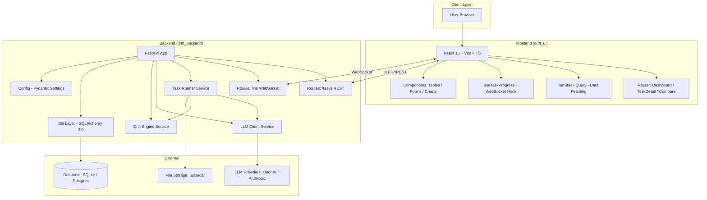
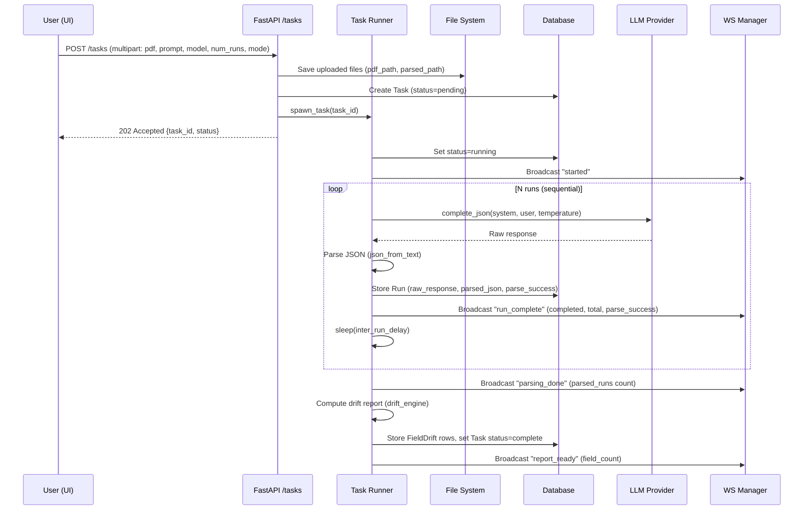
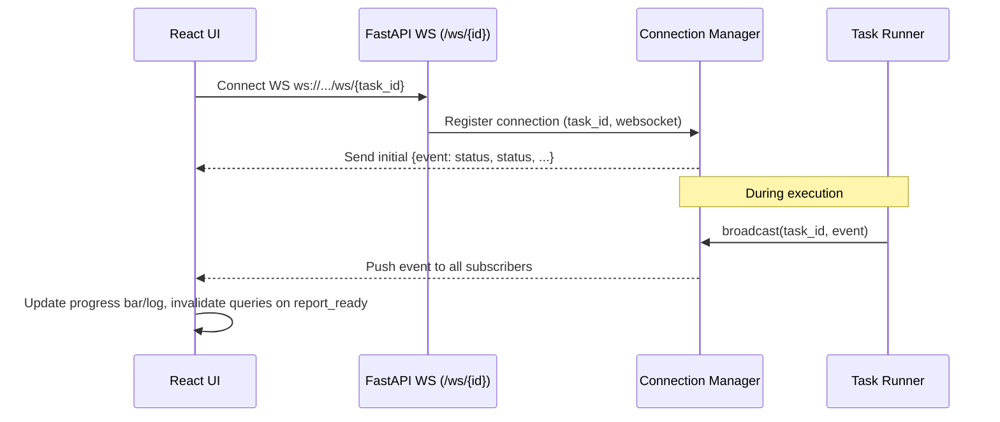
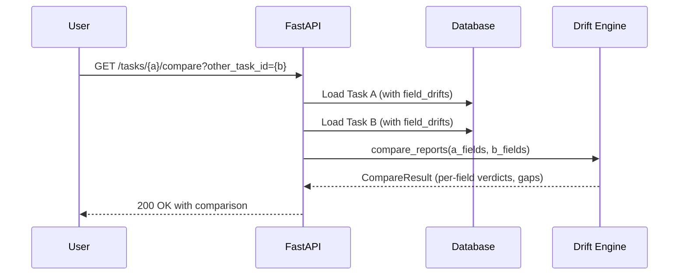
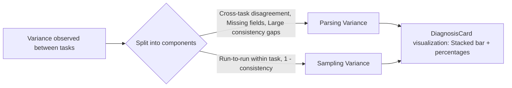

# High-Level Design (HLD) - Drift PDF

## 1. Overview

Drift PDF is a full-stack system for measuring **LLM output drift** - the consistency of JSON extraction from PDF documents across multiple runs. It provides a web-based interface to create drift evaluation tasks, execute multiple LLM calls, compute per-field consistency statistics, and visualize results with live WebSocket progress tracking.

## 2. Goals and Non-Goals

**Goals:**
- Measure consistency of LLM structured extraction from PDFs
- Support multiple LLM providers (OpenAI, Anthropic)
- Provide real-time progress feedback during long-running multi-run evaluations
- Enable comparison between different extraction runs/tasks
- Offer clear diagnosis of variance sources (parsing vs sampling)

**Non-Goals:**
- Training/fine-tuning models
- PDF OCR/vision-heavy preprocessing beyond text extraction
- Complex workflow orchestration beyond single task execution
- Production-grade authentication/authorization

## 3. System Context

```text
User (Browser) ---> React UI (drift_ui) ---> FastAPI (drift_backend) ---> LLM Providers (OpenAI/Anthropic)
                                                    |
                                                    +-- SQLite/Postgres (Storage)
                                                    +-- File System (Uploads)
```

## 4. High-Level Architecture



## 5. Component Overview

| Component | Responsibility |
| --- | --- |
| **Frontend (React)** | User interface, task creation/upload, progress display, drift visualization, comparison |
| **REST API** | Task CRUD, reporting, comparison endpoints, file uploads |
| **WebSocket Manager** | Real-time progress broadcasting (run completion, parsing, report ready, failures) |
| **Task Runner** | Background async orchestration of multi-run execution, lifecycle management, cancellation |
| **LLM Client** | Abstraction over providers, JSON enforcement, retry with exponential backoff, timeout handling |
| **Drift Engine** | Compute per-field statistics, detect types, consistency scoring, classification (stable/drift/unstable) |
| **Database Layer** | Persistence of tasks, runs, field drift results; migrations via Alembic |
| **File Storage** | Store uploaded PDFs and parsed inputs, cleanup on deletion |

## 6. Key Use Cases / Data Flows

### 6.1 Create and Execute Drift Task (Primary Flow)



### 6.2 Real-time Progress via WebSocket



### 6.3 Task Comparison Flow



### 6.4 Drift Diagnosis (Frontend Concept)



## 7. Data Model (Conceptual)

Three core entities:

- **Task**: One drift evaluation job (PDF + prompt + params). Has multiple Runs and FieldDrifts
- **Run**: One LLM invocation result (raw response, parsed JSON if successful, parse success flag)
- **FieldDrift**: Aggregated per-field statistics computed across all successful parsed runs for a task

Relationships: Task 1:N Runs, Task 1:N FieldDrifts, cascaded deletes on removal.

See LLD for detailed schema with types.

## 8. Non-Functional Requirements

| Aspect | Requirement |
| --- | --- |
| **Scalability** | Single-node design; runs executed sequentially per task to respect rate limits. Connection manager tracks in-memory WS connections. |
| **Performance** | Polling only while active tasks; WS for live updates; TanStack Query caching/invalidation. |
| **Reliability** | Retry with exponential backoff for LLM calls; task cancellation on delete/shutdown; error handling with failed status and WS notifications. |
| **Extensibility** | Provider-agnostic LLMClient protocol; easy to add new providers. Drift engine pluggable per field type. |
| **Security** | No secrets logged; uploaded files isolated per task; CORS configurable. API keys read from env. |
| **Data Integrity** | Cascading deletes, FK constraints, JSONB for flexible payloads (Postgres) with JSON fallback (SQLite). |
| **Resiliency** | Sequential runs with inter-run delay to avoid rate limits; timeouts configurable. |

## 9. Technology Decisions

| Choice | Rationale |
| --- | --- |
| **FastAPI** | Async-first, Pydantic v2 integration, auto docs, great for REST + WS. |
| **SQLAlchemy 2.0** | Modern ORM, type-safe Mapped annotations, flexible for SQLite/Postgres. |
| **Alembic** | Schema migrations for production DBs. |
| **Pydantic Settings** | Centralized env config with validation. |
| **PyPDF** | Simple text extraction from PDFs (blackbox mode). |
| **React + Vite + TS** | Fast dev/build, type safety, modern SPA. |
| **TanStack Query v5** | Smart caching, polling control, invalidation on WS events. |
| **Tailwind CSS 4** | Utility-first, fast iteration, dark theme. |
| **Recharts** | Lightweight charts for diagnosis visualization. |

## 10. Deployment View (High-Level)

```mermaid
graph TB
    subgraph Dev["Development"]
        Dev[Developer] --> BE[uvicorn --reload :8000]
        Dev --> FE[Vite dev :5173]
        BE --> SQLite[./drift.db]
        BE --> Uploads[./uploads/]
    end

    subgraph Prod["Production (conceptual)"]
        LB[Load Balancer / Reverse Proxy]
        FE_S[Static Files: dist/ served by Nginx/CDN]
        BE_S[ASGI: Uvicorn / Gunicorn workers]
        PG[(Postgres)]
        FS[Persistent Storage for uploads]
        LB --> FE_S
        LB --> BE_S
        BE_S --> PG
        BE_S --> FS
        BE_S --> LLM[LLM APIs]
    end
```

Notes: Current setup is dev-oriented. For production, consider process management, persistent volumes, DB migrations on startup, and secrets management.

## 11. Future Considerations

- **Parallel runs**: Could speed up when rate limits allow (with concurrency control)
- **Batch comparisons**: Multi-task comparison/reporting
- **Custom field validators**: Schema-aware drift detection
- **Authentication/RBAC**: Multi-user support
- **Export formats**: PDF/CSV reports
- **Caching**: Result caching by input hash
- **Observability**: Logging/metrics/tracing
- **OCR fallback**: For scanned PDFs in blackbox mode
