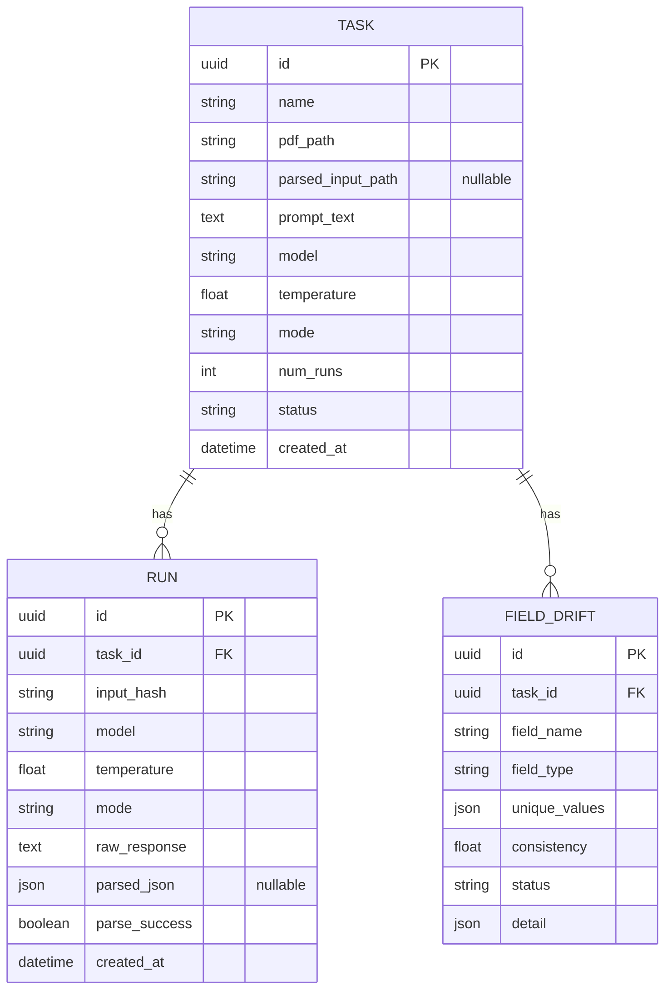
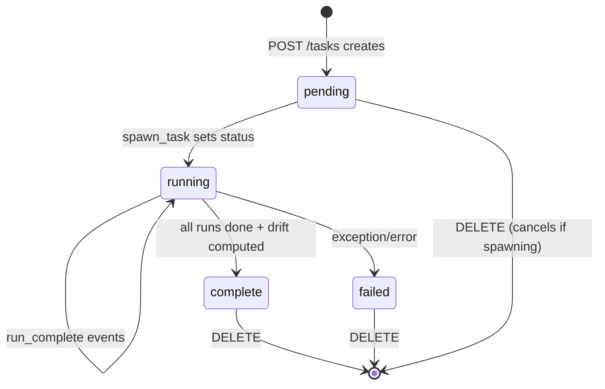
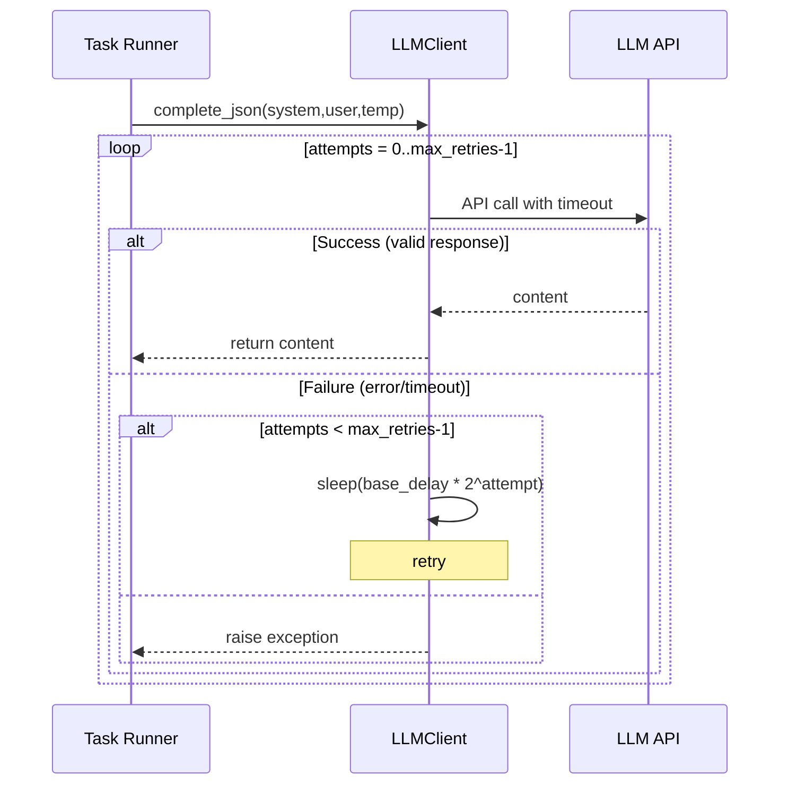
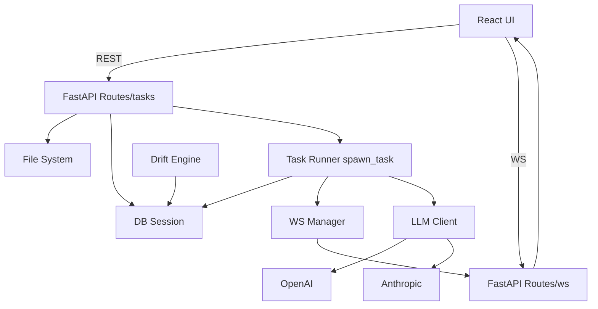

# Low-Level Design (LLD) - Drift PDF

## 1. Purpose

This LLD details the internal design of Drift PDF covering data schema, API contracts, service implementations, WebSocket protocol, drift computation logic, frontend structure, and key algorithms.

## 2. Backend Detailed Design

### 2.1 Project Structure (Backend)

```text
drift_backend/
├── alembic/                # Database migrations
│   ├── env.py
│   └── versions/
│       └── 0001_initial.py
├── app/
│   ├── __init__.py         # __version__
│   ├── config.py           # Pydantic Settings
│   ├── database.py         # Engine/session
│   ├── main.py             # FastAPI app factory + lifespan
│   ├── models.py           # SQLAlchemy 2.0 models
│   ├── schemas.py          # Pydantic v2 schemas
│   ├── routes/
│   │   ├── tasks.py        # REST endpoints
│   │   └── ws.py           # WebSocket endpoints + manager
│   └── services/
│       ├── drift_engine.py # Drift computation
│       ├── llm_client.py   # LLM provider abstraction
│       └── task_runner.py  # Background orchestration
├── tests/                  # Pytest tests
├── alembic.ini
├── requirements.txt
└── README.md
```

### 2.2 Configuration (app/config.py)

Settings (from env):
- `APP_NAME`, `APP_ENV`, `CORS_ORIGINS` (list)
- `DATABASE_URL` (sqlite:///./drift.db or postgresql+psycopg://...)
- `UPLOADS_DIR` (default: "uploads")
- `OPENAI_API_KEY`, `ANTHROPIC_API_KEY`
- `LLM_TIMEOUT` (seconds, default: 120)
- `LLM_MAX_RETRIES` (default: 3)
- `LLM_RETRY_BASE_DELAY` (seconds, default: 0.5)
- `LLM_INTER_RUN_DELAY` (seconds between sequential runs, default: 0.5)
- `MAX_DOCUMENT_CHARS` (truncate document text sent to model, default: 200000)
- `STABLE_CONSISTENCY_THRESHOLD` (default: 0.95)
- `DRIFT_CONSISTENCY_THRESHOLD` (default: 0.5)
- `NUMERIC_RELATIVE_TOLERANCE` (default: 0.0005)
- `MAX_UNIQUE_VALUES` (cap unique_values in responses, default: 200)

Implementation: uses pydantic-settings v2. `get_settings()` returns cached singleton.

### 2.3 Database Layer (app/database.py)

- `Base = DeclarativeBase()` (SQLAlchemy 2.0)
- Engine created lazily from `DATABASE_URL`
- `init_db()` calls `Base.metadata.create_all(bind=engine)` - auto-creates tables at startup (lifespan). Alembic used for migrations in practice.
- `session_scope()` context manager yields Session, commits on success, rolls back on exception, closes session.

### 2.4 Data Models (app/models.py)

#### Constants
- `TASK_MODES = ("blackbox", "parsed")`
- `TASK_STATUSES = ("pending", "running", "complete", "failed")`
- `FIELD_TYPES = ("str", "numeric", "date", "array")`
- `FIELD_STATUSES = ("stable", "drift", "unstable")`

#### Task
| Field | Type | Constraints | Notes |
| --- | --- | --- | --- |
| id | UUID (PK) | default uuid4 | Primary key |
| name | String(255) | not null | User-provided task name |
| pdf_path | String(1024) | not null | Path to saved PDF |
| parsed_input_path | String(1024) | nullable | Path to parsed JSON (if mode=parsed) |
| prompt_text | Text | not null | Extraction prompt |
| model | String(128) | not null | e.g., "gpt-4o-mini", "claude-3-5-sonnet" |
| temperature | Float | default 0.0 | Sampling temp |
| mode | String(32) | default "blackbox" | "blackbox" or "parsed" |
| num_runs | Integer | default 5 | Number of LLM invocations |
| status | String(32) | default "pending" | Task lifecycle state |
| created_at | DateTime (tz-aware) | default utcnow | Creation timestamp |

Relations: `runs` (back_populates="task", cascade delete-orphan, order_by created_at), `field_drifts` (cascade delete-orphan, order_by consistency asc)

#### Run
| Field | Type | Constraints | Notes |
| --- | --- | --- | --- |
| id | UUID (PK) | uuid4 | |
| task_id | UUID (FK) | FK tasks(id, ON DELETE CASCADE), index | |
| input_hash | String(64) | SHA-256 of input bytes | For dedup/tracking |
| model | String(128) | | Model used for this run |
| temperature | Float | | Temp used |
| mode | String(32) | | Mode used |
| raw_response | Text | not null | Full LLM response text |
| parsed_json | JSON/JSONB | nullable | Parsed dict if parse_success |
| parse_success | Boolean | default False | Whether JSON parse succeeded |
| created_at | DateTime(tz) | default utcnow | |

#### FieldDrift
| Field | Type | Constraints | Notes |
| --- | --- | --- | --- |
| id | UUID (PK) | uuid4 | |
| task_id | UUID (FK) | FK tasks(id, ON DELETE CASCADE), index | |
| field_name | String(255) | not null | Field key from JSON |
| field_type | String(32) | not null | "str"/"numeric"/"date"/"array" |
| unique_values | JSON/JSONB | default [] | Distinct values (capped) |
| consistency | Float | default 0.0 | Fraction of runs agreeing with most common (0..1) |
| status | String(32) | default "stable" | Classified status |
| detail | JSON/JSONB | default {} | Type-specific metrics |

JSONField uses `JSON().with_variant(JSONB(), "postgresql")` so SQLite uses JSON, Postgres uses JSONB.

### 2.5 Pydantic Schemas (app/schemas.py)

All response/request models use Pydantic v2:
- `TaskCreated` (task_id, status)
- `RunOut` (ORMModel with from_attributes)
- `FieldDriftOut` (ORMModel)
- `TaskSummary` (aggregated: completed_runs, field_count, worst_field)
- `TaskDetail` (includes runs[], fields[], worst_field)
- `DriftReport` (full report shape)
- `CompareSide`, `CompareField`, `CompareResult` (comparison DTOs)
- `WsMessage` (event schema)

### 2.6 REST API Routes (app/routes/tasks.py)

#### POST /tasks (multipart/form-data)
Creates a new task and starts background execution.

Form fields:
- `name` (str, required)
- `pdf` (UploadFile, required)
- `prompt_text` (str, required)
- `model` (str, required)
- `temperature` (float, default 0.7)
- `mode` (str, default "blackbox")
- `num_runs` (int, default 5)
- `parsed_input` (UploadFile, optional, required if mode="parsed")

Behavior:
1. Validate mode/inputs
2. Save files to `UPLOADS_DIR/`:
   - PDF: `{task_id}_pdf.pdf`
   - Parsed (if present): `{task_id}_parsed_input.{ext or json}`
3. Create Task in DB (status="pending")
4. Call `spawn_task(task_id)` to start background execution
5. Return `202 Accepted` with `TaskCreated`

#### GET /tasks
List all tasks as summaries. Returns `list[TaskSummary]` with computed fields:
- `completed_runs`: count of successful parsed runs
- `field_count`: len(task.field_drifts)
- `worst_field`: field with lowest consistency among drifts, or null

#### GET /tasks/{task_id}
Get full task detail. Returns `TaskDetail` including `runs` (all RunOut), `fields` (FieldDriftOut), `worst_field`.

#### GET /tasks/{task_id}/report
Get machine-readable drift report. Returns `DriftReport`:
```json
{
  "task_id": "...", "task_name": "...", "model": "...", "temperature": 0.7, "mode": "blackbox",
  "num_runs": 5, "parse_success_rate": 1.0,
  "fields": [{"field_name": "total", "field_type": "numeric", "unique_values": [1234.56], "consistency": 1.0, "status": "stable", "detail": {...}}],
  "summary": {"total_fields": 12, "stable": 9, "drift": 2, "unstable": 1, "worst_field": "notes", "worst_consistency": 0.4}
}
```

#### GET /tasks/{task_id}/compare?other_task_id={other}
Compare two tasks' field drift results. Returns `CompareResult` with per-field verdicts: `match`, `similar`, `diverges`, `missing_in_a`, `missing_in_b`.

#### DELETE /tasks/{task_id}
Delete task and associated data:
1. If task running, call `cancel_task(task_id)` to cancel background task
2. Delete uploaded files (pdf_path, parsed_input_path) if they exist
3. Delete task from DB (cascades to runs and field_drifts)
4. Return 204 No Content

### 2.7 WebSocket Routes (app/routes/ws.py)

**Endpoint:** `WS /ws/{task_id}`

ConnectionManager:
- In-memory dict mapping `task_id -> set[WebSocket]`
- `connect(task_id, ws)`: accepts connection, registers, sends initial status message
- `disconnect(task_id, ws)`: removes connection; cleans up empty sets
- `broadcast(task_id, data)`: sends JSON to all connections for that task_id (async)

Event types: `"status"`, `"not_found"`, `"started"`, `"run_complete"`, `"parsing_done"`, `"report_ready"`, `"failed"`

Event payloads:
- `started`: `{event, task_id, total_runs}`
- `run_complete`: `{event, task_id, completed, total_runs, parse_success}`
- `parsing_done`: `{event, task_id, parsed_runs, total_runs}`
- `report_ready`: `{event, task_id, field_count}`
- `failed`: `{event, task_id, error}`

### 2.8 LLM Client (app/services/llm_client.py)

#### Protocol: LLMClient
```python
class LLMClient(Protocol):
    async def complete_json(self, *, system: str, user: str, temperature: float) -> str: ...
```

#### OpenAIClient
- Uses `openai.AsyncOpenAI` with API key from settings
- Forces JSON response: `response_format={"type": "json_object"}`
- Calls `chat.completions.create` with model, messages, temperature, timeout
- Returns `choices[0].message.content` (stripped)

#### AnthropicClient
- Uses `anthropic.AsyncAnthropic` with API key
- Forces JSON via tool use: defines a single tool `extract_json` that takes `data: dict` - implementation uses tool_choice to force tool call returning JSON
- Extracts tool result content as response
- Returns text

#### get_llm_client(model: str) -> LLMClient
Factory: if model name starts with `"claude"`, returns `AnthropicClient()`; otherwise returns `OpenAIClient()`.

#### json_from_text(text: str) -> dict[str, Any]
Extracts JSON from text (handles possible code fences ```json ... ``` or ``` ... ```), then `json.loads()`.

#### Retry logic
Both clients implement retry with exponential backoff: up to `LLM_MAX_RETRIES` attempts. On failure, sleeps `LLM_RETRY_BASE_DELAY * (2^attempt)` and retries. After max retries, re-raises.

### 2.9 Task Runner (app/services/task_runner.py)

#### State tracking
- `_ACTIVE: dict[uuid.UUID, asyncio.Task]` - tracks running tasks by id

#### Public API
- `spawn_task(task_id)`: creates/reuses asyncio task for execution; registers cleanup callback
- `cancel_task(task_id)`: cancels if running
- `shutdown_runner()`: cancels all active tasks on app shutdown
- `is_running(task_id)`: bool
- `extract_pdf_text(path)`: uses PyPDF `PdfReader` to extract text from all pages; raises if no extractable text
- `load_input(task_id)`: returns `(raw_bytes_for_hash, text_to_send)`. For `parsed` mode, reads parsed file as UTF-8 text. For `blackbox`, reads PDF bytes and extracts text, truncates to `MAX_DOCUMENT_CHARS`
- `build_user_prompt(prompt_text, document_text)`: concatenates with separator
- `execute_task(task_id)`: main async logic
- `_mark_failed(task_id, error)`: updates DB status to failed, broadcasts failed event via WS

#### Execution details
- Sequential runs (loop over `range(num_runs)`), not concurrent - respects rate limits
- After each run (except last), sleeps `LLM_INTER_RUN_DELAY` if > 0
- For each run: call client.complete_json, try to parse with json_from_text. Store Run with parse_success flag. If parse_success, collect parsed dict for drift computation.
- If no parsed runs at all, raise RuntimeError ("no runs produced a valid JSON object")
- After runs: compute drift via `drift_engine.compute_drift_report(parsed_runs, settings)`, delete existing FieldDrift rows for task (idempotent), insert new ones, set task status="complete", broadcast report_ready

### 2.10 Drift Engine (app/services/drift_engine.py)

#### Type Detection
`detect_field_type(values: list[Any]) -> str`:
- filters out None (present values)
- if no present values: return "str"
- if all numeric (via `_is_numeric`): "numeric"
- if all array-like (list/tuple): "array"
- if all date-like (via `_is_date`): "date"
- else "str"

`_is_numeric(v)`: rejects bool; accepts int/float (finite); for str, tries float after stripping `, $ %`

`_is_array(v)`: `isinstance(v, (list, tuple))`

`_is_date(v)`: accepts datetime/date; for str, checks format heuristics - starts with 19/20/21, contains date chars, reasonable length.

#### String Similarity
- `levenshtein(a,b)`: standard DP
- `normalized_edit_distance(a,b)`: levenshtein / max(len(a,b)) if longest>0 else 0
- `pairwise_edit_stats(texts)`: avg and max normalized edit distance across all pairs (if >=2 texts)

#### JSON Keying / Uniqueness
- `json_key(v)`: `json.dumps(v, sort_keys=True, default=str)` - stable key for comparison
- `_unique_preserving_order(values)`: dedupe by json_key, preserve first occurrence order
- `_json_safe(v)`: convert datetime/date to isoformat, tuples to lists, non-finite floats to str

#### Field Stats Computation
`compute_field_stats(field_name, per_run_values, settings) -> dict`:
- `per_run_values`: one value per run (None if missing/absent)
- total = len(per_run_values); present = non-None
- field_type = detect_field_type(per_run_values)
- build serializable present list
- for numeric: quantize by relative tolerance to treat noise as same key (scale = max(|mean|*tol, 1e-12), key = str(int(round(n/scale)))) - this is important so small numeric noise doesn't create many unique values
- else keys = [json_key(v) for v in serializable]
- consistency = (count of most frequent key) / total (if total>0)
- unique_values = _unique_preserving_order(serializable) (capped later)
- detail = base {value_count, missing_count} + type-specific via `_type_detail`
- status = `_classify_status(...)` based on field_type, consistency, unique_count, detail
- if numeric and status=="stable", replace unique_values with [mean] (rounded) - cleaner reporting
- cap unique_values to settings.max_unique_values
- return full payload dict matching FieldDrift

#### Type-specific Details (_type_detail)
- **numeric**: mean, std (population), min, max, count (of present numbers)
- **array**: mean_count, min_count, max_count, count_variance, count
- **date**: min, max, unique_count (set of string forms)
- **str**: calls `pairwise_edit_stats` on stringified values -> adds avg/max normalized edit distance

#### Status Classification (_classify_status)
Logic considers thresholds from settings:
- `stable` if `consistency >= STABLE_CONSISTENCY_THRESHOLD` (default 0.95)
- `drift` if `consistency >= DRIFT_CONSISTENCY_THRESHOLD` (0.5) and < STABLE (i.e. in middle)
- else `unstable` (< 0.5)

#### Drift Report Computation
`compute_drift_report(parsed_runs: list[dict], settings) -> list[dict]`:
1. If empty, return []
2. Collect all field names across all parsed runs (union of keys)
3. For each field_name: build `per_run_values` = [run.get(field_name, None) for run in parsed_runs]
4. For each, call `compute_field_stats(field_name, per_run_values, settings)` -> get payload
5. Return list of payloads

#### Comparison
`compare_reports(a_fields: list[FieldDrift], b_fields: list[FieldDrift]) -> list[dict]`:
- Build maps: field_name -> field data for A and B
- Get union of all field names
- For each field_name:
  - a_side = map_a.get(name); b_side = map_b.get(name)
  - if a_side is None and b_side is None: skip
  - if a_side is None: verdict "missing_in_a", a None, b as CompareSide
  - if b_side is None: verdict "missing_in_b", b None, a as CompareSide
  - else: compare both sides -> compute `consistency_gap = |a.consistency - b.consistency|`, determine verdict ("match", "similar", "diverges") based on gap/status difference

Verdict rules: if both stable and values consistent -> "match"; moderate gap -> "similar"; large gap or different extreme statuses -> "diverges". Exact thresholds in code.

### 2.11 App Lifecycle (app/main.py)

- `lifespan(app)`: on startup calls `init_db()`; on shutdown awaits `shutdown_runner()` to cancel active tasks
- `create_app()`: builds FastAPI with title/desc/version, adds CORS middleware from settings, includes routers (tasks, ws), adds `/health` endpoint returning `{"status":"ok","version":...}`
- `app = create_app()` for ASGI

## 3. Frontend Detailed Design

### 3.1 Project Structure (Frontend)

```text
drift_ui/
├── index.html
├── package.json
├── vite.config.ts
├── tsconfig.json
├── tailwind.config.js
└── src/
    ├── main.tsx           # Bootstrap: QueryClient + Router
    ├── App.tsx            # Routes + Nav
    ├── index.css          # Tailwind + base styles
    ├── api/
    │   ├── client.ts       # HTTP client + helpers
    │   └── types.ts        # TS type interfaces
    ├── hooks/
    │   ├── useTasks.ts     # React Query hooks
    │   └── useTaskProgress.ts # WebSocket hook
    ├── components/
    │   ├── DriftTable.tsx
    │   ├── StatusBadge.tsx
    │   ├── ProgressBar.tsx
    │   ├── RawRunAccordion.tsx
    │   ├── ComparePanel.tsx
    │   ├── DiagnosisCard.tsx
    │   └── NewTaskForm.tsx
    └── pages/
        ├── Dashboard.tsx
        ├── TaskDetail.tsx
        └── Compare.tsx
```

### 3.2 API Client (src/api/client.ts)

- Base URL from `VITE_API_URL` (default `http://localhost:8000`)
- HTTP wrapper (fetch) with proper headers for JSON/multipart
- Endpoint helpers: `getTasks()`, `getTask(id)`, `getReport(id)`, `compareTasks(a,b)`, `createTask(formData)`, `deleteTask(id)`, `getDefaultPrompt()`
- WebSocket URL derived: replace `http://` with `ws://` or `https://` with `wss://`, append `/ws/{id}`

### 3.3 Types (src/api/types.ts)

Mirror backend Pydantic schemas: TaskStatus, FieldStatus, FieldType, Mode, CompareVerdict, TaskCreated, TaskSummary, TaskDetail, RunOut, FieldDriftOut, DriftReport, CompareResult, WsMessage, TaskProgress.

### 3.4 React Query Hooks (src/hooks/useTasks.ts)

Uses `@tanstack/react-query` v5.

**Queries:**
- `useTasks()` -> GET /tasks. Polling: 3000ms only if any task in list is `pending` or `running`
- `useTask(id)` -> GET /tasks/{id}. Polling: 2000ms while task.status is `pending` or `running`; otherwise disabled
- `useReport(id)` -> GET /tasks/{id}/report
- `useCompare(a,b)` -> GET /tasks/{a}/compare?other_task_id={b}

**Mutations:**
- `useCreateTask()` -> POST /tasks with FormData; on success, invalidate tasks list and navigate to detail
- `useDeleteTask()` -> DELETE /tasks/{id}; on success, invalidate tasks

**Polling strategy:** Aggressive polling only during active execution; after completion, switch to static data (polling disabled). WebSocket provides instant updates.

### 3.5 WebSocket Hook (src/hooks/useTaskProgress.ts)

`useTaskProgress(taskId, enabled) -> TaskProgress & {log: WsMessage[], connected: boolean}`

Behavior:
- Opens `WebSocket(wsUrl)`, manages connection lifecycle
- On open: set connected=true
- On message: parse JSON as WsMessage, push to log (capped), update progress state based on event
- On close/error: set connected=false; schedules reconnect after 2000ms if still enabled
- On `report_ready` or `failed`: invalidate relevant queries via QueryClient
- Cleanup on unmount/disable: close socket, clear timers

Progress mapping: track `status`, `completedRuns`, `totalRuns`, `fieldCount`, `running` (true if status pending/running)

### 3.6 Pages

#### Dashboard (/)
- Lists all tasks via `useTasks()`
- Shows: name, status badge, model, num_runs, created_at, completed_runs (if available), field_count, worst_field (with color if unstable)
- "New Task" button -> /tasks/new
- Click row -> /tasks/{id}

#### NewTaskForm (/tasks/new)
Form fields:
- name (text)
- pdf (file input)
- mode (radio: blackbox | parsed) - toggles parsed_input visibility
- parsed_input (file input, JSON) - shown only if mode=parsed
- model (select/dropdown)
- temperature (range slider, shows value)
- num_runs (number input)
- prompt_text (textarea)
- "Load default prompt" button - calls GET /prompts/default with fallback to built-in Salesforce Quote extraction prompt

On submit: build FormData, call `useCreateTask().mutateAsync`, navigate to `/tasks/{task_id}`

#### TaskDetail (/tasks/:id)
Composed view:
- Header: task name, status badge, model/temp/mode/num_runs/created_at
- **Live Progress** (while running): ProgressBar showing completed/total runs, event log from WS, parsing_done count, report_ready count
- **Field Drift Table** (DriftTable): columns for field, type, consistency (bar), status badge, unique_values (truncated), detail (expandable). Detail varies by type (numeric stats, string edit distances, array counts, date range)
- **Raw Runs Accordion**: list of runs; each shows parse_success, created_at, input_hash; expandable to show raw_response and parsed_json
- **Compare Panel**: select another task from dropdown; fetch compare result via `useCompare`; shows per-field verdicts with a/b sides
- **Diagnosis Card** (if compare result exists): computes parsing vs sampling split between selected tasks and renders stacked bar + percentages

#### Compare (/compare)
Standalone comparison page: pick two tasks (dropdowns), view full comparison table.

### 3.7 Components

- **StatusBadge**: colored badge for pending/running/complete/failed and stable/drift/unstable
- **ProgressBar**: visual bar + text (e.g., "3/5 runs completed")
- **DriftTable**: main results table with expandable rows for details
- **RawRunAccordion**: collapsible list of individual run results
- **ComparePanel**: renders CompareResult with verdict styling
- **DiagnosisCard**: computes drift attribution
- **NewTaskForm**: task creation form

### 3.8 Drift Diagnosis Algorithm (Frontend)

`DiagnosisCard` takes two tasks' drift data and computes:
- **Parsing component**: variance due to cross-task differences (parsing/input representation). Indicators: fields missing on one side, large consistency gaps between A and B. Computed from CompareResult fields - count weight of "missing_in_a/b", "diverges" cases; also magnitude of consistency_gap where large.
- **Sampling component**: run-to-run variance within each task = `1 - consistency` (averaged appropriately across fields/tasks). Represents randomness from temperature/model.

The card displays: "X% parsing, Y% sampling" with a horizontal stacked bar (Recharts BarChart or simple divs).

### 3.9 Styling & Tooling

- **Tailwind CSS 4**: imported via `@import "tailwindcss"` in index.css; legacy config loaded via `@config "./../tailwind.config.js"`. Trailing important: `px-3!` in v4.
- **Dark theme**: slate-900/slate-800 backgrounds, emerald/amber/red for statuses
- **Vite**: dev server on :5173, build outputs to dist/
- **TypeScript strict**: no implicit any, strict null checks

## 4. Cross-Cutting Concerns

### 4.1 Error Handling
- Backend: try/except in execute_task; catches exceptions, marks task failed, broadcasts error. Validation errors return appropriate HTTP 4xx.
- Frontend: shows errors from API mutations/queries; WS error triggers reconnect.

### 4.2 File Handling
- Uploaded files stored under `UPLOADS_DIR` (default "uploads/")
- Naming: `{task_id}_pdf.pdf`, `{task_id}_parsed_input.{original_ext or .json}`
- Deletion on task DELETE

### 4.3 Concurrency & Async
- Backend fully async (FastAPI, asyncio). Task runner uses asyncio tasks.
- Sequential LLM calls per task (not parallel) to respect provider rate limits.
- WS connections stored in sets per task_id.

### 4.4 Rate Limiting & Retries
- LLM retries: 3 attempts with exponential backoff (base 0.5s, *2^attempt)
- Inter-run delay: configurable (default 0.5s) between sequential runs
- Timeouts: LLM calls have timeout from settings

### 4.5 Security Considerations
- API keys in .env, never committed. Not exposed to frontend.
- CORS origins configurable.
- No user auth in current design (single-user/local dev oriented)
- File paths validated by storing under uploads dir with task_id prefix
- JSON parsing is strict but from trusted LLM responses after validation

### 4.6 Testing

**Backend tests** (pytest):
- Located in `tests/` - includes drift engine tests and full API flow tests
- Use temp SQLite DB, stub LLM client (no real API calls)
- Cover: create task -> run -> drift computation -> report -> compare -> delete

**Frontend:** No explicit test files visible; relies on TypeScript + build checks (`tsc` in build)

## 5. Mermaid Diagrams

### 5.1 ERD (Entity Relationship Diagram)



### 5.2 Task State Machine



### 5.3 Drift Engine Computation Flow

```mermaid
flowchart TD
    A[parsed_runs: list of dicts] --> B{Empty?}
    B -->|Yes| C[Return []]
    B -->|No| D[Collect union of all field names]
    D --> E[For each field_name]
    E --> F[Build per_run_values = run.get(name,None) for each run]
    F --> G[detect_field_type(per_run_values)]
    G --> H[Extract present values]
    H --> I[Compute keys for consistency<br/>numeric: quantize by tolerance<br/>else: json_key]
    I --> J[Compute consistency = max_count/total]
    J --> K[Build unique_values preserve order dedupe]
    K --> L[Compute type-specific detail]
    L --> M[classify_status by thresholds]
    M --> N{numeric and stable?}
    N -->|Yes| O[unique_values = mean]
    N -->|No| P[Keep unique_values]
    O --> Q[Cap unique_values to MAX_UNIQUE_VALUES]
    P --> Q
    Q --> R[Return field stats dict]
    R --> S{More fields?}
    S -->|Yes| E
    S -->|No| T[Return all field stats]
```

### 5.4 LLM Client Retry Logic



### 5.5 Component Interaction Map



## 6. Configuration Reference

Key env vars (see .env.example in backend):
```dotenv
# App
CORS_ORIGINS=http://localhost:5173,http://127.0.0.1:5173

# Database
DATABASE_URL=sqlite:///./drift.db

# LLM
OPENAI_API_KEY=
ANTHROPIC_API_KEY=
LLM_TIMEOUT=120
LLM_MAX_RETRIES=3
LLM_RETRY_BASE_DELAY=0.5
LLM_INTER_RUN_DELAY=0.5

# Drift thresholds
STABLE_CONSISTENCY_THRESHOLD=0.95
DRIFT_CONSISTENCY_THRESHOLD=0.5
NUMERIC_RELATIVE_TOLERANCE=0.0005
MAX_UNIQUE_VALUES=200
MAX_DOCUMENT_CHARS=200000
```

## 7. API Contract Summary

| Endpoint | Method | Request | Response | Notes |
| --- | --- | --- | --- | --- |
| /health | GET | - | {status, version} | Health check |
| /tasks | POST | multipart form | 202 {task_id,status} | Starts background run |
| /tasks | GET | - | TaskSummary[] | List tasks |
| /tasks/{id} | GET | - | TaskDetail | Full detail + runs + fields |
| /tasks/{id}/report | GET | - | DriftReport | Machine-readable report |
| /tasks/{id}/compare | GET | query other_task_id | CompareResult | Side-by-side diff |
| /tasks/{id} | DELETE | - | 204 | Cancels if running, deletes files+data |
| /ws/{id} | WS | - | WsMessage stream | Live progress |

## 8. Notes & Assumptions

- Runs are executed sequentially (not in parallel) per task - by design for rate limiting.
- In `parsed` mode, the parsed_input file is sent as-is (UTF-8 decoded) to the model as document context. The LLM call still goes out - "parsed" mode means the input representation is pre-parsed; the backend still calls the LLM with that parsed content according to the prompt.
- Numeric quantization uses relative tolerance to collapse floating point noise into same value for consistency calculation.
- Status classification is primarily driven by consistency thresholds; type affects detail fields.
- WS connections are in-memory - lost on server restart.
- File uploads stored on local filesystem - not suitable for distributed deployments without shared storage.
